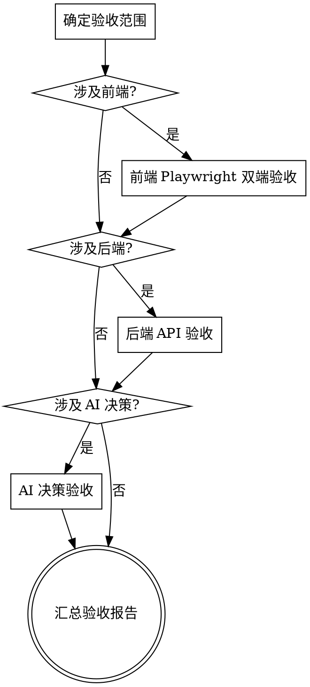

# 端到端验收测试

## Overview

验收不是验证"它对",而是**验证"它没错"**。用找茬的心态去测,不是走马观花看一遍页面。

核心原则:测试覆盖三个维度——**UI/UX 视觉交互** + **API 功能正确性** + **AI 决策能力**。每个维度都有自己的方法论和验收标准。

## 触发方式

```
/etoe                          ← 完整验收流程
/etoe 事件中心页面验收            ← 指定验收范围
/etoe 后端 narrative API 测试    ← 仅后端
/etoe AI 跨主体路由场景测试       ← 仅 AI 决策
```

## 验收流程



---

## 一、前端 Playwright 双端验收

### 工具

使用 Playwright MCP（navigate_page / click / take_snapshot / take_screenshot / resize_page / evaluate_script 等）**手动逐步交互**。

**⚠️ 禁止写 Playwright 测试脚本（.spec.ts）。** 脚本测试只能检查元素存在性和文字匹配，看不到 UI 布局问题、视觉不一致、信息密度不合理等 UX 问题。必须用 MCP 工具逐个点击、逐个截图、用视觉能力逐帧审查。

操作流程：
1. `navigate_page` 导航到目标页面
2. `take_screenshot` 截图 → 视觉审查布局/样式/内容
3. `take_snapshot` 获取 a11y 树 → 找到要点击的元素 uid
4. `click` 点击按钮/Tab/列表项
5. 再次 `take_screenshot` → 审查交互后的状态变化
6. `resize_page` 切换桌面端/移动端 → 重复以上流程
7. 每一步都**用视觉判断是否有问题**，而不是用断言检查

### 双端要求

| 端 | 视口 | 必须测 |
|---|---|---|
| 桌面端 | 1440×900 | 布局、双栏、hover 效果、键盘可达性 |
| 移动端 | 375×812 | 单栏适配、抽屉/Sheet 交互、文字截断、触摸目标 44px |

### 测试维度

**1. 用户流程遍历(UX)**

不是看到页面就行——**模拟人的操作**,一个按钮、一段输入、一个跳转全部走一遍:
- 页面加载 → 看到什么(空状态 or 数据)
- 点击每个 tab → 数据是否正确切换
- 输入搜索 → 结果是否过滤
- 点击列表项 → 详情是否展开
- 关闭详情 → 是否回到列表
- 分页(如有) → 翻页后数据对不对

**2. 视觉找茬(UI)**

| 检查项 | 怎么找 |
|---|---|
| 文字挤压 | 长标题是否截断而非溢出 |
| 表述不一致 | 跨页面同一概念用词是否统一(如"事件"vs"叙事") |
| 信息密度 | 卡片内容是否过密或过疏 |
| 无用信息 | 有没有用户看不懂的 UUID、内部状态码 |
| 圆角阴影不一致 | 跨页面卡片样式是否统一 |
| 空状态 | 无数据时是否有友好文案(不是空白) |
| 状态颜色 | badge 颜色是否符合语义(红=危险、绿=正常) |

**3. 边界情况**

- 超长标题(200 字 intent)→ 是否截断
- 大量参与人(10+)→ 显示是否合理
- 快速连续点击 → 是否重复请求
- 网络慢(可用 Playwright 限速)→ loading 态是否正确
- 未登录访问 → 是否正确重定向

### 输出格式

```markdown
## 前端验收报告

### 桌面端 (1440×900)
| 测试项 | 结果 | 截图 | 备注 |
|---|---|---|---|

### 移动端 (375×812)
| 测试项 | 结果 | 截图 | 备注 |
|---|---|---|---|

### 发现的问题
| # | 级别 | 描述 | 截图 | 是否阻塞 |
|---|---|---|---|---|
```

---

## 二、后端 API 验收

### 两类接口,两种测法

**非 AI 类接口(CRUD / 状态机 / 权限)**

用 curl 直接测。每个端点测两组:

| 组 | 内容 | 示例 |
|---|---|---|
| 正常组 | 合法输入,预期成功 | 创建叙事,传 intent="xxx" → 201 |
| 异常组 | 非法输入,预期失败 | 缺必填字段 → 400;不存在的 ID → 404;非法状态转换 → 400 |

**AI 类接口(LLM 决策 / 工具执行)**

需要带入**复杂的真实场景**。测两个能力:

| 能力 | 含义 | 怎么测 |
|---|---|---|
| 决策能力 | prompt + 上下文 + 约束条件能否让 AI 做出正确判断 | 构造场景,看 AI 选了什么工具、做了什么决定 |
| 执行能力 | 工具调用后是否得到预期结果 | 验证 DB 状态、API 返回、副作用(如飞书消息) |

### 测试数据设计原则

**等价类划分(Equivalence Partitioning)**

把输入分成"等价组",每组测一条代表:
- 有效输入:正常长度的 intent、合法的 UUID
- 无效输入:空字符串、超长、非 UUID 格式、SQL 注入尝试

**边界值分析(Boundary Value Analysis)**

bug 最爱躲在边界:
- 时间窗口:刚好 7 天 vs 7 天零 1 秒
- 阈值:confidence 0.49 vs 0.50
- 数量:0 个候选 vs 1 个 vs 20 个(上限)
- 字符串:空 vs 1 字 vs 200 字(max)

**状态转换测试(State Transition Testing)**

画出所有状态,测所有合法路径 + 所有非法路径:
```
合法: draft→active→waiting→active→completed→archived
非法: archived→active (终态不可转)
非法: active→draft (不可回退)
幂等: active→active (应返回原对象)
```

### 测试数据清理

**红线:不污染开发数据库。** 测完必须删除所有测试数据。
- 创建时加标记(如 intent 包含 "[TEST]")
- 测完用 DELETE API 清理
- 验证清理完成(查询返回 0)

### 输出格式

```markdown
## 后端验收报告

### 非 AI 接口
| 端点 | 场景 | 输入 | 预期 | 实际 | 结果 |
|---|---|---|---|---|---|

### AI 接口
| 场景 | Agent 决策 | 工具调用 | DB 状态 | 结果 |
|---|---|---|---|---|
```

---

## 三、AI 决策验收

### 核心:用真实的人话,不用工程师语言

真实用户说的话是模糊的、带指代的、有省略的:

```
❌ 工程师语言(不要用):
"请查询 narrative_id 为 xxx 的状态"

✅ 真实人话(必须用):
"哎那个王总上次发的那个方案,帮我找一下"
"那个报名的事进展怎么样了"
"上次说的那个环境问题解决了没"
"算了不用了"
"😄"
```

### 测试集设计

**维度 1:四象限覆盖**

| 象限 | 含义 | 必须测的场景 |
|---|---|---|
| 1人×1平台 | 单用户单平台 | 简单问答、闲聊过滤、叙事创建 |
| 1人×N平台 | 同一人跨平台 | Web 发起 → 飞书追问(如有条件) |
| N人×1平台 | 多人同平台 | ask_user 跨主体路由 → 回复回流 |
| N人×N平台 | 跨平台跨人 | 完整场景(如有条件) |

**维度 2:等价类消息**

每个叙事准备 5 类消息:
1. **明确属于**:直接提到叙事关键词
2. **模糊属于**:用指代/省略/口语化表述
3. **闲聊**:跟叙事完全无关
4. **无语义**:表情/确认词/"好的"/"收到"
5. **跨叙事**:同时沾边两个叙事(竞争)

**维度 3:对抗性测试**

- 连续 5 条无关消息后,第 6 条回到叙事 → 还能接上吗?
- 完全换一种说法描述同一件事 → 还能匹配吗?
- 用户说"算了不做了" → 是取消叙事还是继续?
- 用户打了一个错字 → 容错能力

### 评估指标

| 指标 | 计算 | 目标 |
|---|---|---|
| 精确率(Precision) | 正确挂载 / 所有挂载 | > 90% |
| 召回率(Recall) | 正确挂载 / 应该挂载 | > 70% |
| F1 | 2×P×R/(P+R) | > 0.8 |
| 闲聊过滤率 | 正确拒绝 / 所有闲聊 | > 95% |

**注意:我们系统设计倾向"宁缺毋滥"(confidence < 0.5 不挂),所以 Precision 优先于 Recall。**

### 输出格式

```markdown
## AI 决策验收报告

### findOrAttach 归属判定
| # | 消息(人话) | 预期 | 实际 | 对? |
|---|---|---|---|---|

精确率: X/Y = Z%
召回率: X/Y = Z%
F1: Z

### 跨主体路由
| # | 场景 | 步骤 | 预期 | 实际 | 对? |
|---|---|---|---|---|---|

### 发现的问题
| # | 级别 | 描述 |
|---|---|---|
```

---

## 四、验收报告汇总模板

```markdown
# [功能名] 验收报告

**验收日期**: YYYY-MM-DD
**验收范围**: 前端/后端/AI 决策

## 总结
| 维度 | 测试数 | 通过 | 失败 | 通过率 |
|---|---|---|---|---|

## 阻塞性问题(必须修)
| # | 描述 | 影响 |

## 非阻塞问题(建议修)
| # | 描述 | 建议 |

## 结论
✅ 通过 / ❌ 不通过(附原因)
```

---

## 五、集成链路场景验收

### 核心哲学

**单个功能对 ≠ 系统能用。** 功能只有串在一起、在真实场景中从头到尾跑通，才算真正可用。

单元测试验证的是"这块砖没裂"。集成场景验证的是"砖砌成的房子住不住得了人"。前端截图看到页面能渲染、后端 API 返回 200、jest 测试全绿——这些都不代表系统可用。必须把所有功能串成完整的业务链路，带入真实场景，从起点走到终点，验证最终产出是否正确。

### 两类场景，缺一不可

**第一类：正常场景（Happy Path）**

一个典型的、最常见的业务流程，从头到尾完整走一遍：
- 选一个真实的业务操作（不是 mock 数据）
- 从用户的第一步操作开始
- 经过所有中间处理环节
- 一直到最终产出物（数据落库、页面展示、通知送达）
- 每一步都验证：上一步的输出是不是下一步的正确输入？

**第二类：边界场景（Edge Cases）**

在正常场景的基础上，针对链路中的每个环节设计边界情况：
- 如果某一步的输入为空？
- 如果某一步超时或失败，下游怎么处理？
- 如果数据中有脏值（空字符串、特殊字符、类型不匹配）？
- 如果两个并发请求同时触发同一条链路？
- 如果用户在链路执行中途做了意外操作？

边界场景不是一个，而是**每个环节都可能有多个**。关键是：在边界情况下，整条链路是优雅降级还是直接崩溃？

### 怎么做

**1. 画出完整链路**

在测试前，先把业务链路画清楚：
```
步骤 A → 步骤 B → 步骤 C → ... → 最终产出
```
明确每一步的输入是什么、输出是什么、谁消费这个输出。

**2. 确认运行环境**

代码改动后，必须确认：
- 运行中的服务加载了最新代码（不是旧版本、不是别的项目）
- 服务启动日志无报错
- 依赖服务（数据库、缓存、第三方 API）连通正常

**3. 摸底真实数据**

不要凭空构造测试数据。先看真实环境里有什么：
- 有多少条业务数据？分布如何？
- 真实数据的字段值长什么样？（可能和你假设的完全不同）
- 哪些用户是活跃的？关联了哪些外部账号？

**4. 跑正常场景**

```
触发前：记录关键指标基线（数量、状态）
触发：从链路起点开始操作
等待：让整条链路跑完（不要只跑一半就看结果）
触发后：对比关键指标变化
前端验证：最终产出在页面上是否正确展示
```

**5. 跑边界场景**

对链路中的每个环节，至少测一个边界情况：
```
环节 A 的边界：输入为空 → 链路是否优雅跳过？
环节 B 的边界：数据有脏值 → 是报错还是静默忽略？
环节 C 的边界：外部服务不可用 → 是否有降级？
跨环节边界：A 的输出格式变了 → B 能否兼容？
```

### 常见陷阱

| 陷阱 | 表现 | 根因 |
|------|------|------|
| "单测全过所以没问题" | 部署后服务启动崩溃 | mock 屏蔽了模块依赖缺失 |
| "页面能渲染所以没问题" | 展示的数据全是空或错的 | 只看了 UI 没看数据来源 |
| "API 返回 200 所以没问题" | 数据库没有任何变化 | 业务逻辑条件不满足，静默跳过 |
| "本地跑通了" | 线上跑的是旧代码 | 没确认进程加载了最新代码 |
| "mock 数据跑通了" | 真实数据有脏值导致类型错误 | mock 数据太干净，不反映真实分布 |
| "单个接口测过了" | 接口串起来数据传不过去 | A 的输出格式不是 B 期望的 |

### 场景设计模板

```markdown
### 正常场景：[场景名称]

**链路**：步骤 A → 步骤 B → ... → 最终产出
**参与角色**：[真实用户/角色]

| 步骤 | 操作 | 预期结果 | 实际结果 | 通过？ |
|------|------|---------|---------|-------|

### 边界场景 1：[边界描述]

**触发条件**：[什么情况下会触发这个边界]
**预期行为**：[优雅降级 / 报错提示 / 静默跳过]

| 步骤 | 操作 | 预期结果 | 实际结果 | 通过？ |
|------|------|---------|---------|-------|

### 边界场景 2：...
```

---

## 设计原则速查

| 原则 | 一句话 | 来源 |
|---|---|---|
| 等价类划分 | 同类输入测一条代表 | 经典黑盒测试 |
| 边界值分析 | bug 躲在边界,测极值 | 经典黑盒测试 |
| 状态转换 | 测所有合法+非法路径 | 状态机测试 |
| 找茬心态 | 验证"它有没有错"而非"它对不对" | 验收测试哲学 |
| 真实人话 | 用模糊/口语化/带指代的表述 | AI 系统测试 |
| 宁缺毋滥 | Precision > Recall,错挂比漏挂严重 | Anthropic Evals |
| 不污染数据 | 测试数据必须清理 | 开发红线 |
| 双端必测 | 桌面 + 移动,布局/交互都要 | 响应式验收 |
| 功能对≠系统能用 | 必须串成链路用真实数据跑完整场景 | 集成测试哲学 |
| 正常+边界双覆盖 | 正常场景跑通 + 每个环节至少一个边界 | 场景化测试 |
| 确认运行环境 | 改完代码先确认服务加载了最新版本 | 血泪教训 |
